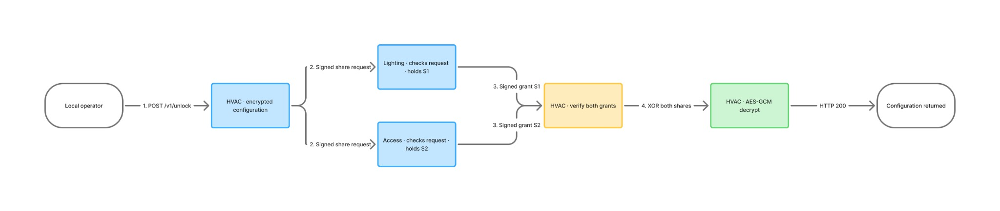

# Federated File System Encoding at the Edge in Smart Buildings Simulation

## Project Description

This project is a Python and FastAPI simulation of secure communication and encrypted data storage in smart buildings. It includes three controllers: **HVAC**, **Lighting**, and **Access**. Each controller runs as a separate service on the same computer.

Each controller stores its configuration in an encrypted file. To decrypt that file through the system, it must request two parts of its encryption key from the other controllers. The system uses digital signatures and security checks before releasing these key shares.

The project demonstrates encryption, authentication, distributed key management, and protection against replay attacks. It is an educational simulation, not a complete physical smart-building system or a mounted file system.

## Main Idea

The main idea is **not to store the complete encryption key together with the encrypted file**. During setup, the key is split into two parts using XOR, and each part is stored on a different peer controller.

For example, for HVAC:

- **HVAC** stores its own encrypted temperature configuration.
- **Lighting** stores the first share of HVAC's encryption key (`S1`).
- **Access** stores the second share (`S2`).

HVAC needs both valid shares to rebuild the key:

`Key = S1 XOR S2`

This is a **2-of-2 policy**: both other controllers must take part in the normal unlock process. Lighting and Access use the same method to unlock their own configurations.

## System Architecture



[View the architecture explanation](docs/ARCHITECTURE.md) | [Edit the diagram in Figma / FigJam](https://www.figma.com/board/DUEyVEA1NS2K7VFEM7iB4T)

The diagram shows one example: HVAC asks Lighting and Access for their key shares, checks the signed replies, reconstructs its key, and decrypts its configuration.

| Controller | Role | Local address |
|---|---|---|
| HVAC | Temperature configuration | `127.0.0.1:8101` |
| Lighting | Lighting configuration | `127.0.0.1:8102` |
| Access | Building access configuration | `127.0.0.1:8103` |

Every controller has encrypted data, its own Ed25519 signing key, trusted peer information, shares belonging to other controllers, and a local SQLite database for replay protection and security events.

## Tools Used

| Tool / technology | Purpose |
|---|---|
| Python 3.11+ | Main programming language |
| FastAPI | HTTP endpoints for controllers |
| Uvicorn | Runs the services |
| Pydantic | Validates requests and responses |
| HTTPX | Sends requests between controllers |
| Cryptography | Provides encryption and digital signatures |
| AES-256-GCM | Encrypts and authenticates stored configuration data |
| Ed25519 | Signs and verifies protocol messages |
| SHA-256 | Computes and compares file hashes |
| XOR | Splits and reconstructs encryption keys |
| SQLite | Stores used nonces and audit records |

## Project Flow

### 1. Initialization

The system starts with an offline setup process called **provisioning**. It creates signing keys, encrypted configuration files, trusted public-key information, and two shares of each encryption key. The shares are placed with the other two controllers.

### 2. Unlock Request

A local operator sends `POST /v1/unlock` to a controller. For example, HVAC creates a new request with its identity, a random nonce, timestamps, and hashes of its files. HVAC signs the request using Ed25519.

### 3. Request Verification

HVAC sends the signed request to Lighting and Access through `POST /v1/share`. Each peer checks the requester identity, signature, time window, expected hashes, and whether the request nonce was already accepted. SQLite records accepted nonces to prevent replay attacks.

### 4. Key Share Collection

If the checks pass, each peer sends back a signed response containing its share of HVAC's key. HVAC verifies that both responses are authentic and belong to the current request.

### 5. Decryption

After receiving both valid shares, HVAC combines them with XOR and uses AES-256-GCM to decrypt its configuration. The decrypted data is returned in the API response. The service does **not** write an `unlocked.txt` file or save the complete reconstructed key to disk.

If a required peer is unavailable or refuses the request, the normal unlock process fails.

## API Endpoints

| Method | Endpoint | Purpose |
|---|---|---|
| GET | `/health` | Returns controller status |
| POST | `/v1/share` | Checks a signed request and returns a signed key share |
| POST | `/v1/unlock` | Requests both shares and decrypts the local configuration |

## Project Structure

```text
src/building_federation/
    __init__.py
    __main__.py
    api.py           HTTP API
    cli.py           Command-line startup
    crypto.py        Encryption, signatures and XOR
    demo.py          Demonstration scenarios
    models.py        Request and response models
    provision.py     Initial setup and key distribution
    service.py       Unlock and peer-verification logic
    settings.py      Configuration validation
    state.py         SQLite replay protection

docs/
    ARCHITECTURE.md
    architecture.jpg
    SECURITY.md

README.md
pyproject.toml
```

## How to Run

### 1. Set up the environment

Use **Python 3.11 or newer**. Run these commands from the project directory on macOS or Linux:

```bash
python3 --version
python3 -m venv .venv
source .venv/bin/activate
python -m pip install .
```

### 2. Create the controller data

```bash
python -m building_federation provision --root runtime
```

This creates a new `runtime/` directory with the three controllers. Choose a different directory name if `runtime/` already exists; provisioning will not overwrite an existing one.

### 3. Run the controllers

Open **three terminals**, activate the same virtual environment in each one, and run one command per terminal:

**Terminal 1 — HVAC**

```bash
python -m building_federation serve --root runtime --node hvac
```

**Terminal 2 — Lighting**

```bash
python -m building_federation serve --root runtime --node lighting
```

**Terminal 3 — Access**

```bash
python -m building_federation serve --root runtime --node access
```

### 4. Check the system and request an unlock

In a fourth terminal:

```bash
curl http://127.0.0.1:8101/health
curl -X POST http://127.0.0.1:8101/v1/unlock \
  -H 'Content-Type: application/json' -d '{}'
```

Example successful result:

```json
{
  "status": "unlocked",
  "node_id": "hvac",
  "approved_by": ["lighting", "access"],
  "data": {
    "controller": "hvac",
    "settings": {
      "zone": "floor-1",
      "target_temperature_c": 22
    }
  }
}
```

You can also open the FastAPI documentation at `http://127.0.0.1:8101/docs` while HVAC is running.

## System Demonstration

The project has a separate demonstration script. It starts three local HTTP services, demonstrates eight scenarios, and then stops the temporary services:

```bash
python -m building_federation.demo
```

The demonstration covers successful unlocks, repeated requests, replay protection after restart, invalid signatures, modified files, unavailable peers, and recovery after a peer restarts. A successful demonstration prints eight `PASS` messages.

The demo normally uses ports `18101–18103`. If they are busy, use another available range, for example:

```bash
python -m building_federation.demo --base-port 19101
```

## Security Features and Limitations

The main security mechanisms are AES-256-GCM encryption, Ed25519 message signatures, SHA-256 file checks, a 2-of-2 XOR key-sharing policy, and SQLite replay protection.

There are important limits:

- All controllers run on one computer and are not physically isolated.
- Peers communicate through local HTTP without TLS encryption.
- The local unlock endpoint has no separate operator login.
- If one required peer is unavailable, the normal unlock process fails.
- A fully compromised controller or computer can bypass some assumptions of this simulation.

Do not expose these endpoints to a local network or the Internet. More detail is available in [SECURITY.md](docs/SECURITY.md).

## Future Development Ideas

- Run controllers on separate physical edge devices.
- Add authenticated HTTPS connections between controllers.
- Add operator authentication and key rotation.
- Improve availability with a different key-sharing approach.
- Create a small dashboard showing controller status and security events.
