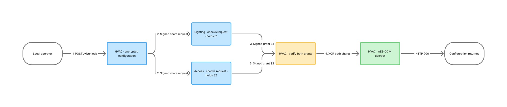

# System Architecture

**Project:** Federated File System Encoding at the Edge in Smart Buildings Simulation

## 1. System Overview

This project simulates a small smart building system with three controllers: **HVAC**, **Lighting**, and **Access**. They run as separate FastAPI services on one computer and communicate through local HTTP requests.

Each controller has its own encrypted configuration file. To read this file, it needs two parts of its encryption key from the other controllers. This is called a **2-of-2 key-sharing policy**.

The diagram below shows how **HVAC** unlocks its configuration. Lighting and Access follow the same process when they need to unlock their own data.

## 2. Architecture Diagram

[Open the editable diagram in Figma / FigJam](https://www.figma.com/board/DUEyVEA1NS2K7VFEM7iB4T)

The arrows show the main steps: HVAC sends a signed request, receives two signed key shares, combines them using XOR, and decrypts its configuration using AES-GCM.

## 3. Main Components

| Controller | Main role | Local address |
|---|---|---|
| **HVAC** | Stores a temperature configuration | `127.0.0.1:8101` |
| **Lighting** | Stores a lighting configuration | `127.0.0.1:8102` |
| **Access** | Stores an access configuration | `127.0.0.1:8103` |

Each controller has an Ed25519 signing key, encrypted data, information about trusted peers, and a local SQLite database. It also holds key shares for the other two controllers.

## 4. How the Keys Are Distributed

During **offline provisioning**, the system creates encryption keys and encrypts each controller's configuration. Each encryption key is split into two random-looking shares using XOR. The shares are placed on the *other* two controllers.

For example, HVAC's complete encryption key is not stored with its encrypted file:

- **Lighting** holds HVAC's first key share (`S1`).
- **Access** holds HVAC's second key share (`S2`).
- HVAC reconstructs the key only after receiving both valid shares: `K = S1 XOR S2`.

The same arrangement is used for Lighting and Access. The encrypted configuration stays on its owner controller.

## 5. Unlock Process

1. **Start:** A local operator sends `POST /v1/unlock` to HVAC.
2. **Create a request:** HVAC creates a new nonce, adds timestamps and file hashes, and signs the request with Ed25519.
3. **Ask both peers:** HVAC sends the signed request to Lighting and Access using `POST /v1/share`.
4. **Check security:** Each peer verifies the signature, time window, expected file hashes, and whether the nonce was already used.
5. **Receive key shares:** If the checks pass, each peer returns a signed response with its key share. HVAC verifies these responses.
6. **Decrypt:** HVAC combines both shares using XOR and decrypts its file with AES-256-GCM. The configuration is returned through the API.

If either peer is unavailable or rejects the request, the normal unlock process fails.

## 6. Security Mechanisms

| Technology | Purpose |
|---|---|
| **AES-256-GCM** | Encrypts the configuration and checks its integrity during decryption |
| **Ed25519** | Signs and verifies requests and responses |
| **SHA-256** | Checks file hashes against the values saved during provisioning |
| **XOR** | Splits and reconstructs a 32-byte encryption key |
| **Nonce and expiration time** | Help prevent old requests from being accepted |
| **SQLite** | Records used nonces to stop replay attacks, including after a restart |

## 7. Important Limitations

This is an **educational local simulation**, not a production smart building security system.

- The three controllers run on **one computer**, without real device isolation.
- The controllers communicate over **local HTTP**, without TLS encryption. Signed messages are not the same as encrypted network traffic.
- The local unlock endpoint does not authenticate a human operator.
- A fully compromised controller may be able to request and keep key shares. The file-hash checks are not proof of trusted software execution.
- Both other controllers must be available for a normal unlock operation.

These limitations are important when explaining how the design would need to change for real buildings.
